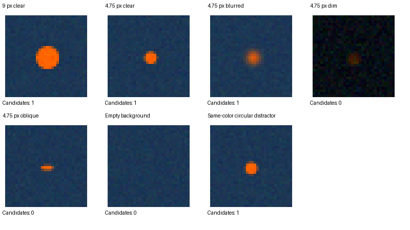

# SDGOSS target detection experiment

Reproduction of the **color-and-shape target detection subsystem** experiment in the individual SDGOSS subsystem analysis. The original detector and experiment script is preserved byte for byte. This repository includes the report's archived results and a separately executed reproduction.

The experiment evaluates a deliberately simple HSV threshold and connected-component detector. Its supported conclusion is negative: the tested detector fails the proposed dim-scene, target-discrimination, and desktop timing criteria. These synthetic results do not validate detection at 1.5 miles or operation on a Jetson.

## Run it

Use Python 3.12 (the original execution recorded Python 3.12.14). In a virtual environment:

```sh
python -m pip install -r requirements.txt
python detector_test.py
python verify_results.py
```

The first script generates `results.json` and `synthetic-examples.png` next to itself. The verifier reads these fresh results, compares the detection counts and geometry with `results/report/results.json`, and writes `verification.json`. A mismatch exits with an error. Generated root-level files are gitignored so a rerun does not overwrite the committed archives.

NumPy is pinned to the original recorded version, 2.3.5. Pillow is pinned to 12.3.0, the version used for the reproduction; the original JSON did not record a Pillow version. Other dependency/platform combinations are not guaranteed to produce identical rasterization or noise results.

## Expected results

Seed: **423**. Each condition has **100 independently generated 128 x 128 RGB frames**, for **700 frames** in total. A positive target frame counts as detected if any accepted candidate centroid is within 2 pixels of the known center. A negative frame is a false positive if any candidate is returned.

| Condition | Positive frames / total | Metric |
| --- | ---: | --- |
| 9 px clear target | 100 / 100 | Recall 100% |
| 4.75 px clear target | 100 / 100 | Recall 100% |
| 4.75 px blurred target | 100 / 100 | Recall 100% |
| 4.75 px dim target | 0 / 100 | Recall 0% |
| 4.75 px oblique target | 57 / 100 | Recall 57% |
| Empty background | 0 / 100 | False-positive frame rate 0% |
| Same-color circular distractor | 100 / 100 | False-positive frame rate 100% |

Across the four 4.75-pixel target conditions, recall is 257/400 = **64.25%**, rounded to **64.3%** in the report. Across the equally weighted two negative conditions, the false-positive frame rate is 100/200 = **50%**. These averages reflect this artificial condition weighting, not operational event frequencies.

The original desktop CPU benchmark recorded median **339.768 ms**, 95th percentile **390.051 ms**, and maximum **401.816 ms**. Those historical measurements are preserved in `results/report/results.json`. **New timing values are measured, not forced to match.** Host, system load, and interpreter differences affect timing. The verifier deliberately excludes timing from numeric equality checks.

## Detector and scene design

The script converts normalized RGB to HSV, with hue in degrees, and retains pixels satisfying 10 <= H <= 45 degrees, S >= 0.55, and V >= 0.30. It implements its own eight-connected labeling in Python; it does not call OpenCV. Accepted components have area 6–1000 pixels, width/height 0.5–2.0, and fill fraction >= 0.45. It returns centroids, areas, widths, and heights. There is no learned model, tracking, gimbal control, or drone flight control.

Scenes use background RGB (28,55,85) and target RGB (255,100,0), 4 x 4 subpixel coverage sampling, and random center offsets within +/-0.5 pixels. Gaussian channel noise is independently drawn per frame. The exact parameter order and random-number consumption are retained in `detector_test.py`. Blur is a Pillow Gaussian filter, not a physical motion-blur model.

The long-range diameter is fixed to 4.7462636 pixels in the generator. The geometry calculation uses image width 1920 pixels, horizontal field of view 2.4 degrees, assumed target diameter 0.25 m, and approximate range 2414 m (about 1.5 miles):

```text
fx = 1920 / (2 * tan(2.4 degrees / 2)) = 45829.9213501 pixels
d  = fx * 0.25 m / 2414 m            = 4.746263603 pixels
A  = pi * (d/2)^2                   = 17.692678712 pixels squared
6/A                                = 0.339123323
```

The 0.25 m target is an analysis assumption, not a confirmed mechanical requirement. These ideal projection calculations omit atmosphere, lens blur, vibration, acquisition, and camera noise calibration. A continuous disk area is not guaranteed segmented pixel area.

The oblique target uses a minor/major axis ratio of 0.4. The distractor intentionally uses the same appearance model as the clear target: it tests the inability of color/shape features alone to establish identity. It is not evidence of a measured real-world distractor distribution.

The timing protocol uses one 1920 x 1080 RGB frame with a sparse target mask, three warmups, and 30 measured detector calls. It excludes camera capture, communications, and control. It is not a worst-case clutter benchmark or a Jetson/GPU benchmark.

## Repository contents

- `detector_test.py`: unchanged original experiment and detector.
- `verify_results.py`: independent comparison against the archived numerical results.
- `results/report/`: original report JSON and example image.
- `results/reproduction/`: freshly executed results, example image, and verification record.
- `requirements.txt`: dependencies used for reproduction.



## Sources and authorship

Conceptual references: [OpenCV HSV thresholding tutorial](https://docs.opencv.org/4.13.0/da/d97/tutorial_threshold_inRange.html), [OpenCV component statistics](https://docs.opencv.org/3.4.8/d3/dc0/group__imgproc__shape.html), and [Sony FCB-EV9520L datasheet](https://pro.sony/s3/2024/11/19143008/FCBEV9520L_h.pdf). The Sony camera is a proposed analysis input, not confirmed integrated hardware.

AI assistance was used to develop the original prototype and report and to package and execute this reproduction. Executed checks are software comparisons of synthetic outputs. No independent human review, flight test, real-camera experiment, or Jetson performance validation is claimed. The report's proposed 90% recall interpretation and 1% false-positive allocation are design assumptions, not independently approved sponsor requirements.
